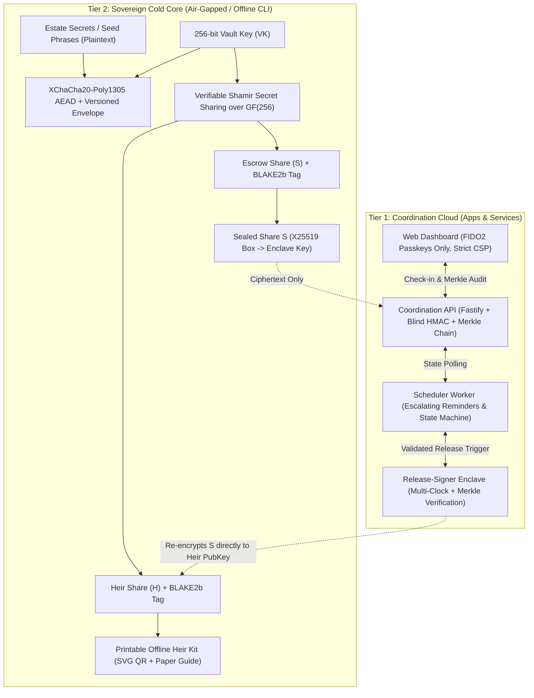
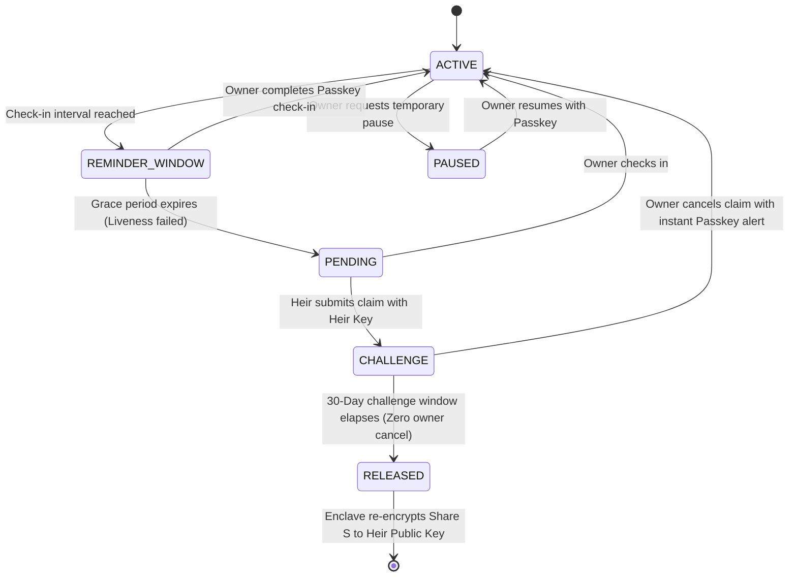

# Crypto Inheritance Platform (CIP)

> **Sovereign, Zero-Knowledge, Non-Custodial Digital Asset Continuity Protocol**  
> *Defense-in-depth against nation-state APTs, cloud hypervisor compromise, CDN hijacking, and social engineering.*

---

## 1. Executive Architecture & Invariants

Real generational wealth, private estate secrets, and family legacies depend on cryptographic guarantees rather than institutional trust. The **Crypto Inheritance Platform** is architected so that **correctness and mathematical security strictly outrank speed**.



### The 5 Non-Negotiable Invariants

1. **Two-Tier Secret Separation ([ADR-0001](file:///g:/CODE/crypto%20inheretence%20platform/docs/adrs/ADR-0001-two-tier-secret-separation.md)):**
   The browser web client (`apps/web`) and API (`apps/api`) **never** collect, accept, process, transmit, log, or store unencrypted seed phrases, private keys, or raw threshold shares. Secret generation and splitting occur strictly offline via `packages/cli` on an air-gapped machine.
2. **No Invented Cryptography ([ADR-0002](file:///g:/CODE/crypto%20inheretence%20platform/docs/adrs/ADR-0002-cryptographic-suites.md)):**
   All cryptography uses vetted primitives (`libsodium-wrappers-sumo`, `@noble/hashes`):
   - Symmetric Ciphertext: `XChaCha20-Poly1305` authenticated encryption with authenticated associated data ($AD$).
   - Threshold Secret Sharing: Verifiable Shamir over $\text{GF}(256)$ with BLAKE2b share commitments.
   - Asymmetric Enclave Seals: `X25519-XChaCha20-Poly1305` authenticated sealed boxes.
   - Digital Event Signatures: `Ed25519` (RFC 8032).
3. **Passkeys Only ([ADR-0003](file:///g:/CODE/crypto%20inheretence%20platform/docs/adrs/ADR-0003-passkey-identity.md)):**
   FIDO2 WebAuthn resident keys are strictly required for owner and heir authentication. Passwords, SMS, and email OTPs are banned. Email is a notification transport, never proof of liveness.
4. **Isolated Enclave Release with Multi-Clock Anchors ([ADR-0004](file:///g:/CODE/crypto%20inheretence%20platform/docs/adrs/ADR-0004-isolated-enclave-release.md)):**
   Only `apps/release-signer` (<1,000 LOC, zero outbound internet egress) can decrypt escrow share $S$. It independently verifies monotonic Ed25519 Merkle event chains and hardware RTC against signed Roughtime beacons to prevent cloud hypervisors from warping system time to bypass the 30-day challenge window.
5. **Cryptographic Bundle Verification:**
   Before loading the web application, users can verify web bundle integrity against release signatures using `cip verify-bundle --dir apps/web/dist`.

---

## 2. Monorepo Organization

```
├── packages/
│   ├── crypto-core/      # Mathematical foundation (XChaCha20, Shamir GF(256), X25519, Argon2id) - 100% test coverage
│   ├── protocol/         # Shared schemas, Drizzle models, state machine transitions, event chain types
│   ├── cli/              # Sovereign air-gapped CLI (cip) for vault creation, key splitting, recovery & bundle verification
│   └── ui/               # Reusable headless UI primitives
├── apps/
│   ├── web/              # React 19 + Tailwind SPA (FIDO2 passkeys, countdown timers, Merkle audit trail)
│   ├── api/              # Fastify coordination API (blind HMAC email index, Merkle event chain, RLS)
│   ├── worker/           # State machine scheduler & escalating notification dispatcher (30d, 14d, 7d, 72h)
│   └── release-signer/   # Minimalist isolated enclave microservice (<1,000 LOC, Multi-Clock Roughtime validation)
├── infra/
│   └── docker/           # Hermetic multi-stage Dockerfiles (unprivileged users, read-only FS, hardened Nginx)
├── docs/adrs/            # Formal Architecture Decision Records (ADR-0001 through ADR-0004)
├── tasks/                # Master plan and implementation checklist
└── docker-compose.yml    # Local multi-service orchestration with internal enclave air-gap network
```

---

## 3. Cryptographic Specification

### Secret Splitting ($VK \to H, S$)
The Vault Key ($VK \in \{0,1\}^{256}$) encrypts the user's estate payload using authenticated associated data bound to the Vault UUID:
$$\text{Ciphertext} = \text{XChaCha20-Poly1305}_{\text{Encrypt}}(VK, \text{Nonce}, \text{Payload}, AD)$$
where $AD = \text{"CIP\_VAULT"} \parallel \text{Version} \parallel \text{VaultID}$.

$VK$ is then split into an $(n, k)$ threshold scheme (default $2$-of-$2$) over the Galois Field $\text{GF}(256)$:
- **Share $1$ ($H$ - Heir Share):** Printed onto the sovereign paper Heir Kit or stored offline by the heir.
- **Share $2$ ($S$ - Escrow Share):** Sealed with the Enclave's X25519 public key ($\text{Sealed}_S$) and uploaded to the platform.
- **Share Commitments:** Every share $i$ includes a 32-byte BLAKE2b commitment $C_i = \text{BLAKE2b}(i \parallel S_i)$ preventing rogue share replacement.

### Liveness State Machine


---

## 4. Quickstart Guide

### Prerequisites
- **Node.js:** `v22.0.0+`
- **pnpm:** `v10.0.0+`
- **Docker & Docker Compose** (for containerized local orchestration)

### 1. Installation & Monorepo Build
```bash
# Clone the repository
git clone https://github.com/crypto-inheritance-platform/crypto-inheritance-platform.git
cd "crypto inheretence platform"

# Install dependencies (strictly frozen lockfile)
pnpm install

# Run typechecking across all 8 packages
pnpm typecheck

# Run test suites with full coverage reports
pnpm test
```

### 2. Air-Gapped Sovereign CLI Usage (`cip`)

The `cip` utility is entirely self-contained with **zero network dependencies**. Transfer it to an air-gapped machine via USB:

```bash
# 1. Encrypt your estate payload (BIP-39 mnemonic, private keys, estate instructions)
node packages/cli/bin/cip.js init-vault \
  --input estate-secrets.txt \
  --out-vault vault-package.json \
  --out-key vault.key

# 2. Split Vault Key into 2-of-2 Shamir shares with BLAKE2b commitments
node packages/cli/bin/cip.js split-key \
  --key-file vault.key \
  --vault-id <VAULT_UUID> \
  --threshold 2 \
  --total-shares 2 \
  --out-dir ./shares

# 3. Seal the Escrow Share to the Enclave's public key
node packages/cli/bin/cip.js seal-share \
  --share-file ./shares/share-2-escrow.txt \
  --recipient-pubkey <ENCLAVE_PUBLIC_KEY_HEX> \
  --out sealed-escrow.hex

# 4. Generate the printable offline Heir Kit document (includes SVG QR code & recovery guide)
node packages/cli/bin/cip.js heir-kit \
  --share-file ./shares/share-1-heir.txt \
  --vault-package-file vault-package.json \
  --heir-name "Alice Smith" \
  --out-html heir-kit.html

# 5. Delete raw secrets and vault.key
shred -u vault.key estate-secrets.txt
```

### 3. Heir Offline Recovery

If the hosted platform ever goes offline, heirs need only their Heir Kit share and the released escrow share to reconstruct the original secrets without any server communication:

```bash
node packages/cli/bin/cip.js recover \
  --vault-package vault-package.json \
  --shares share-1-heir.txt released-share-2.txt \
  --out recovered-estate.txt
```

### 4. Web Application Bundle Verification

Verify that your local or hosted frontend assets have not been modified or tampered with by CDNs, DNS providers, or compromised servers:

```bash
node packages/cli/bin/cip.js verify-bundle --dir apps/web/dist
```

---

## 5. Running the Full Stack Locally

Run all coordination services, database, scheduler, isolated enclave, and hardened web client:

```bash
# Build and run all microservices via Docker Compose
docker compose up --build -d

# Check service health
docker compose ps

# Web Dashboard: http://localhost:8080
# API Service:   http://localhost:3000/health
# Enclave:       http://localhost:3001/health (Internal Docker Network Only)
```

---

## 6. Security Assurance & Auditing

- **Automated Semgrep Rules:** Any import of `crypto`, `libsodium-wrappers-sumo`, `@noble/*` inside `apps/web` or `apps/api` immediately fails build pipelines ([.semgrep/security-rules.yaml](file:///g:/CODE/crypto%20inheretence%20platform/.semgrep/security-rules.yaml)).
- **Supply Chain Security:** Strict lockfiles, pinned action hashes, and `ignore-scripts = true` in `.npmrc`.
- **Secret Scanning:** Integrated `gitleaks` pre-commit hooks and CI scans.
- **Constant-Time Verification:** All cryptographic comparisons and commitments use `sodium.memcmp` to eliminate side-channel timing leaks.

For vulnerability reporting, see [SECURITY.md](file:///g:/CODE/crypto%20inheretence%20platform/SECURITY.md).

---

## 7. License

Licensed under the Apache License, Version 2.0 or the MIT License at your option. See [LICENSE](LICENSE) for details.

