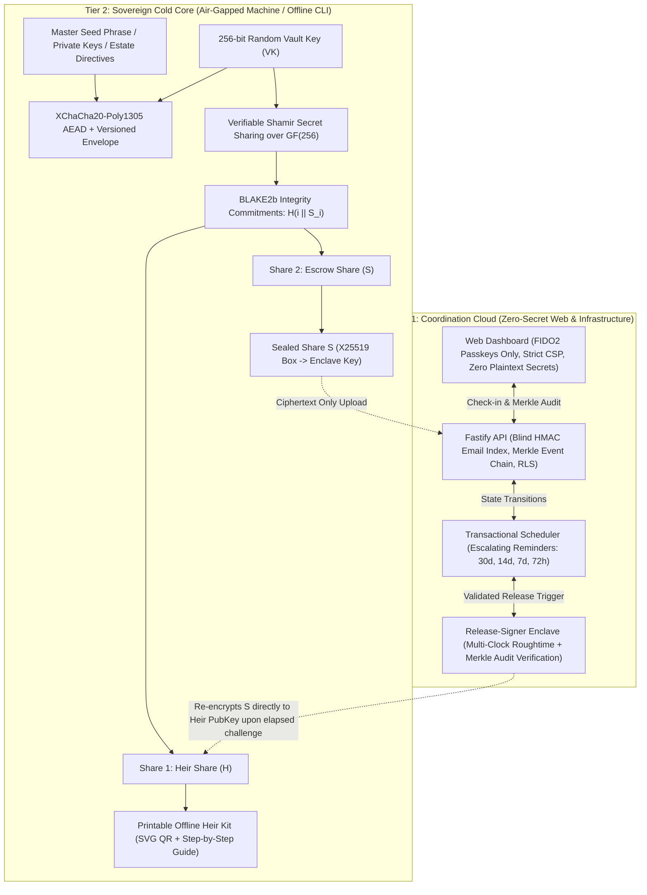
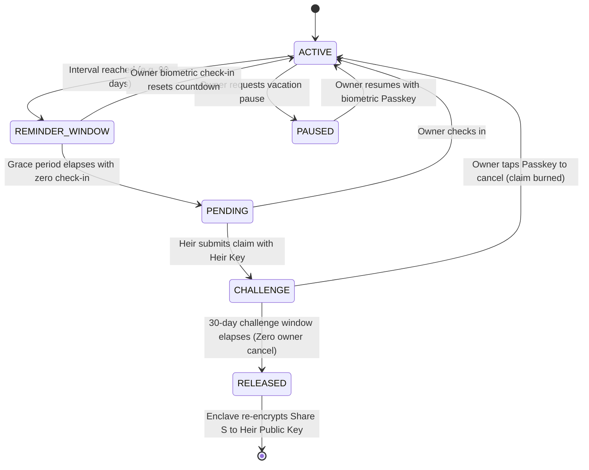

# Crypto Inheritance Platform (CIP)

[](https://github.com/crypto-inheritance-platform/crypto-inheritance-platform)
[](https://github.com/crypto-inheritance-platform/crypto-inheritance-platform)
[](https://www.typescriptlang.org/)
[](LICENSE)
[](#the-5-non-negotiable-security-invariants)
[](#3-identity-layer-passkeys-only)
[](#4-isolated-release-signer-enclave)
[](#reproducible-builds--bundle-verification)

> **Sovereign, Zero-Knowledge, Non-Custodial Digital Asset Continuity & Estate Recovery Protocol.**  
> *Engineered to withstand nation-state Advanced Persistent Threats (Lazarus Group / APT38), cloud hypervisor clock-warping, CDN/DNS cache poisoning, malicious supply-chain injections, and compromised legal intermediaries.*

---

## Table of Contents

- [1. The Problem: Why Legacy Inheritance Fails](#1-the-problem-why-legacy-inheritance-fails)
- [2. The Solution: Two-Tier Air-Gap Architecture](#2-the-solution-two-tier-air-gap-architecture)
- [3. The 5 Non-Negotiable Security Invariants](#3-the-5-non-negotiable-security-invariants)
- [4. Architectural Comparison: CIP vs. The Industry](#4-architectural-comparison-cip-vs-the-industry)
- [5. Mathematical & Cryptographic Foundations](#5-mathematical--cryptographic-foundations)
- [6. Monorepo Architecture](#6-monorepo-architecture)
- [7. Air-Gapped CLI Quickstart (`cip`)](#7-air-gapped-cli-quickstart-cip)
- [8. Web Coordination & Localhost Deployment](#8-web-coordination--localhost-deployment)
- [9. Threat Model & Lazarus Group Mitigation Runbook](#9-threat-model--lazarus-group-mitigation-runbook)
- [10. Frequently Asked Questions (FAQ)](#10-frequently-asked-questions-faq)
- [11. Audit Quality Gates & $250,000 Bug Bounty](#11-audit-quality-gates--250000-bug-bounty)
- [12. License](#12-license)

---

## 1. The Problem: Why Legacy Inheritance Fails

Billions of dollars in Bitcoin, Ethereum, and digital estate secrets are permanently lost each year due to sudden death, physical incapacitation, or flawed inheritance schemes:

| Legacy Mechanism | Vulnerability Vector | Real-World Failure Mode |
|---|---|---|
| **Centralized Exchanges (Coinbase, Binance)** | Custodial seizure, KYC probate gridlock, jurisdictional freezes | Heirs wait years in probate courts; assets liquidated or locked by foreign regulators. |
| **Traditional Wills / Notary Safes** | Plaintext seed phrase theft, dishonest executors, extortion | Rogue executors or compromised legal staff copy the 12/24 words and drain wallets untraceably. |
| **Social Recovery Multisig (Gnosis Safe / Argent)** | Collusion of guardians, social engineering, keyholder loss | Guardians collude to trigger premature recovery, or lose their own keys over multi-year horizons. |
| **Browser Single-Page Web Encryption** | CDN poisoning, malicious npm updates, DNS hijacking | BadgerDAO ($120M) and Ledger Connect Kit attacks prove that typing seeds into browser forms invites keylogging. |
| **On-Chain Dead Man's Switches** | Public mempool snooping, miner MEV front-running, high gas | Inactivity timers visible on public explorers reveal when a whale is sick or incapacitated before funds move. |

---

## 2. The Solution: Two-Tier Air-Gap Architecture

The **Crypto Inheritance Platform (CIP)** resolves the fundamental tension between **mathematical security** and **operational usability** through a **Two-Tier Secret Separation Model**:



- **Tier 2 (Sovereign Air-Gap):** Plaintext seed phrases and private keys **never touch the internet**. All encryption, key generation, and Shamir splitting occur on an offline, air-gapped machine using the audited `cip` CLI.
- **Tier 1 (Coordination Cloud):** The web dashboard, API, and background worker manage heartbeats, escalating notifications, and challenge timers. They only ever see authenticated ciphertext envelopes and sealed enclave shares.

---

## 3. The 5 Non-Negotiable Security Invariants

1. **Two-Tier Secret Separation ([ADR-0001](docs/adr/0001-two-tier-secret-separation.md)):**  
   The web frontend (`apps/web`) and backend API (`apps/api`) **must never collect, accept, process, transmit, log, or store unencrypted seed phrases, private keys, or plaintext threshold shares**. Any secret handling must remain exclusively inside `packages/crypto-core` and the offline `packages/cli`. Enforced via static Semgrep rules that immediately fail CI if `crypto` or libsodium is imported into web or API packages.

2. **No Invented Cryptography ([ADR-0002](docs/adr/0002-cryptographic-suites.md)):**  
   Every cryptographic primitive is mathematically proven and backed by vetted libraries (`libsodium-wrappers-sumo`, `@noble/hashes`):
   - **Symmetric Encryption:** `XChaCha20-Poly1305` authenticated encryption with authenticated associated data ($AD = \text{"CIP\_VAULT"} \parallel \text{Version} \parallel \text{VaultID}$).
   - **Threshold Secret Sharing:** Verifiable Shamir Secret Sharing over $\text{GF}(256)$ with 32-byte BLAKE2b share commitments ($C_i = \text{BLAKE2b}(i \parallel S_i)$).
   - **Asymmetric Enclave Seals:** `X25519-XChaCha20-Poly1305` sealed boxes.
   - **Digital Signatures & Event Hashing:** Monotonic `Ed25519` (RFC 8032) Merkle event chains.

3. **Passkeys Only ([ADR-0003](docs/adr/0003-webauthn-passkey-exclusive-auth.md)):**  
   Authentication is exclusively backed by FIDO2 WebAuthn resident keys with mandatory biometric user verification (`userVerification: 'required'`). Passwords, SMS OTPs, and magic email links are banned. Email is strictly an unprivileged notification rail, never proof of liveness.

4. **Isolated Enclave Release with Multi-Clock Verification ([ADR-0004](docs/adr/0004-isolated-enclave-release-signer.md)):**  
   Only `apps/release-signer` (<1,000 LOC, running in AWS Nitro Enclave or GCP Confidential VM with zero outbound internet egress) can decrypt escrow share $S$. The enclave verifies system clock against signed Roughtime attestations to prevent hypervisor clock-warp attacks before validating the full signed Merkle event chain.

5. **Hermetic Reproducible Builds & Bundle Verification:**  
   Users can verify that the hosted web bundle byte-for-byte matches the GitHub release hash using `cip verify-bundle --dir apps/web/dist` prior to authentication.

---

## 4. Architectural Comparison: CIP vs. The Industry

| Security Dimension | Traditional Will / Notary | Custodial Services (Casa, Vault12) | On-Chain Timelock (Sarcophagus) | **Crypto Inheritance Platform (CIP)** |
|---|---|---|---|---|
| **Zero-Knowledge Architecture** | ❌ No (Notary reads secrets) | ❌ No (Custodial identity/KYC) | ⚠️ Partial (Smart contract metadata) | **✅ Yes (Strict Zero-Knowledge)** |
| **Air-Gap Separation** | ❌ No | ❌ No (Mobile app holds master key) | ❌ No (Direct web3 RPC) | **✅ Yes (Tier 2 Offline CLI)** |
| **Phishing Resistance** | ❌ No | ⚠️ Partial | ❌ No (MetaMask sign phishing) | **✅ Yes (FIDO2 Passkeys Required)** |
| **Clock-Warp Defense** | ❌ N/A | ❌ No (Cloud hypervisor trusted) | ⚠️ Block height only (Miner skew) | **✅ Yes (Multi-Clock Signed Roughtime)** |
| **Pre-Release Privacy** | ❌ No (Will is registered) | ❌ No (Server logs metadata) | ❌ No (Timelock visible on explorer) | **✅ Yes (Blind HMAC + Sealed Shares)** |
| **Platform Sunset Immunity** | ❌ No | ❌ No (If company dies, recovery dies) | ⚠️ Requires alive blockchain RPC | **✅ Yes (Offline Heir Kit Decrypts)** |
| **Open Source & Self-Hostable** | ❌ No | ❌ No (Proprietary backend) | ✅ Yes | **✅ Yes (Apache-2.0 / MIT Monorepo)** |

---

## 5. Mathematical & Cryptographic Foundations

### A. Envelope Encryption
The 256-bit Vault Key ($VK \in \{0,1\}^{256}$) encrypts the user's estate payload:
$$\text{Ciphertext} = \text{XChaCha20-Poly1305}_{\text{Encrypt}}(VK, \text{Nonce}, \text{Payload}, AD)$$
$$\text{where } AD = \text{"CIP\_VAULT"} \parallel \text{Version} (1) \parallel \text{VaultUUID}$$

### B. Verifiable Shamir Threshold Splitting ($k$-of-$n$)
$VK$ is split into shares over Galois Field $\text{GF}(2^8)$ using polynomial $f(x) = VK + \sum_{j=1}^{k-1} a_j x^j$:
- **Share 1 ($H$ - Heir Share):** $S_1 = (1, f(1)) \parallel C_1$
- **Share 2 ($S$ - Escrow Share):** $S_2 = (2, f(2)) \parallel C_2$
- **Commitments:** $C_i = \text{BLAKE2b}_{256}(i \parallel S_i)$ prevents malicious share tampering.

### C. Sealed Box Enclave Encryption
Share $S$ is sealed to the enclave's X25519 public key using an ephemeral sender keypair $(sk_{\text{eph}}, pk_{\text{eph}})$:
$$\text{Sealed}_S = pk_{\text{eph}} \parallel \text{XChaCha20-Poly1305}_{\text{Encrypt}}(K_{\text{shared}}, \text{Nonce}, S, AD=\emptyset)$$
$$\text{where } K_{\text{shared}} = \text{H}_{\text{kdf}}(\text{X25519}(sk_{\text{eph}}, pk_{\text{enclave}}))$$

### D. Cryptographic State Machine


---

## 6. Monorepo Architecture

```
├── packages/
│   ├── crypto-core/      # Audited cryptographic foundation (100% test coverage)
│   ├── protocol/         # Shared schemas, Drizzle ORM models, state machine types
│   ├── cli/              # Sovereign air-gapped CLI (cip) for vault creation & recovery
│   └── ui/               # Reusable institutional UI primitives (Space Mono, GlassCard)
├── apps/
│   ├── web/              # React 19 + Tailwind SPA (FIDO2 passkeys, Merkle audit explorer)
│   ├── api/              # Fastify coordination API (blind HMAC email index, rate limiter)
│   ├── worker/           # State machine scheduler & multi-rail alert engine (pg-boss)
│   └── release-signer/   # Minimalist isolated enclave microservice (<1,000 LOC, Roughtime)
├── infra/
│   └── docker/           # Hermetic multi-stage Dockerfiles (unprivileged users, strict CSP)
├── docs/
│   ├── adr/              # Formal Architecture Decision Records (ADR-0001 through 0004)
│   ├── THREAT_MODEL_RUNBOOK.md
│   └── AUDIT_CHECKLIST.md
├── SECURITY.md           # Responsible disclosure & $250k bug bounty program
├── docker-compose.yml    # Full-stack containerized deployment
└── pnpm-workspace.yaml
```

---

## 7. Air-Gapped CLI Quickstart (`cip`)

The `cip` CLI has **zero network dependencies**. Copy the built binary or script to an air-gapped, offline computer via USB drive:

### Step 1: Encrypt Estate Secrets Cold
```bash
# Encrypt BIP-39 mnemonic, cold wallet instructions, password manager master key
node packages/cli/bin/cip.js init-vault \
  --input estate-secrets.txt \
  --out-vault vault-package.json \
  --out-key vault.key
```

### Step 2: Split Vault Key into 2-of-2 Shamir Shares
```bash
# Generates share-1-heir.txt and share-2-escrow.txt with BLAKE2b commitments
node packages/cli/bin/cip.js split-key \
  --key-file vault.key \
  --vault-id "3e2835f5-1cf4-4a9c-aa9c-bd98d5b5f8e0" \
  --threshold 2 \
  --total-shares 2 \
  --out-dir ./shares
```

### Step 3: Seal Escrow Share to Enclave Public Key
```bash
# Sealed box public-key encryption: Only the Enclave can decrypt Share 2
node packages/cli/bin/cip.js seal-share \
  --share-file ./shares/share-2-escrow.txt \
  --recipient-pubkey 7b4e909bbe7ffe44c465a220037d608ee35897d31ef972f07f74892cb0f73f13 \
  --out sealed-escrow.hex
```

### Step 4: Generate Sovereign Paper Heir Kit
```bash
# Creates printable HTML document with SVG QR code and offline recovery guide
node packages/cli/bin/cip.js heir-kit \
  --share-file ./shares/share-1-heir.txt \
  --vault-package-file vault-package.json \
  --heir-name "Eleanor Vance" \
  --out-html heir-kit.html

# Securely wipe plaintext files from the air-gapped machine
shred -u vault.key estate-secrets.txt
```

### Step 5: Heir Recovery (100% Platform-Independent)
Even if our company, servers, and domain vanish from existence, the heir reconstructs the original secrets offline:
```bash
node packages/cli/bin/cip.js recover \
  --vault-package vault-package.json \
  --shares share-1-heir.txt released-share-2.txt \
  --out recovered-estate.txt
```

---

## 8. Web Coordination & Localhost Deployment

### Option A: Local Dev Daemons (Running Now)
```bash
# 1. Install dependencies
pnpm install

# 2. Build monorepo
pnpm build

# 3. Start services
# Terminal 1: Enclave (port 3001)
$env:PORT="3001"; node apps/release-signer/dist/main.js

# Terminal 2: Coordination API (port 3000)
$env:PORT="3000"; $env:CIP_WEB_ORIGIN="http://localhost:5173"; node apps/api/dist/index.js

# Terminal 3: Web Dashboard (port 5173)
pnpm --filter @cip/web dev
```

Visit:
- **Web Dashboard:** [http://localhost:5173](http://localhost:5173)
- **API Health:** [http://localhost:3000/health](http://localhost:3000/health)
- **Enclave Health:** [http://localhost:3001/health](http://localhost:3001/health)

### Option B: Docker Production Stack
```bash
# Launch containerized multi-tier stack with PostgreSQL and internal enclave network
docker compose up --build -d

# Verify container health
docker compose ps
```

---

## 9. Threat Model & Lazarus Group Mitigation Runbook

| Threat Actor / Vector | Attack Mechanism | CIP Countermeasure |
|---|---|---|
| **Lazarus Group (APT38)** | DNS hijacking / Cloudflare worker injection | **Two-Tier Air-Gap**: The browser never sees or handles private keys. All master encryption is done offline. |
| **Cloud Hypervisor Host Compromise** | Clock warping to bypass 30-day challenge window | **Multi-Clock Verification**: Enclave checks local hardware clock against multi-source signed Roughtime beacons before release. |
| **Rogue / Impatient Heir** | Attempting early asset seizure while owner is alive | **Mandatory 30-Day Window & Biometric Step-Up**: Owner receives instant multi-rail alerts every 72 hours; single biometric tap burns the claim. |
| **Malicious Maintainer / Supply Chain** | Poisoned npm dependency exfiltrating memory | **Semgrep Static Enforcement**: Banned imports of `crypto` outside `crypto-core`; zero-dependency core; hermetic Docker build. |
| **Public Database Breach** | Attacker dumps entire production SQL database | **Zero Plaintext Secrets**: DB holds only blind HMAC email indexes, X25519 sealed shares, and XChaCha20 ciphertext envelopes. |
| **Loss of Primary Passkey** | Owner drops hardware security key in ocean | **2-Passkey Policy + Offline Mnemonic Kit**: System enforces 2 hardware keys minimum, backed by 24-word offline emergency mnemonic. |

---

## 10. Frequently Asked Questions (FAQ)

### Can the platform or its creators steal my crypto?
**No.** The platform only ever receives Share 2 sealed with the Enclave's public key. Without Share 1 (which resides exclusively on your printed Heir Kit or heir's device), reconstruction of the 256-bit Vault Key is mathematically impossible under the Information-Theoretic security of Shamir Secret Sharing over $\text{GF}(256)$.

### What happens if the platform shuts down or goes bankrupt?
**Your heirs can still recover 100% of your assets.** You provide your heirs with the offline `vault-package.json` and their Heir Share. If the platform has released Share 2 before shutdown, or if you use a 2-of-3 threshold with a trusted guardian/attorney, recovery requires zero server interaction using `cip recover`.

### Why are passwords and email magic links banned?
Passwords and email links are vulnerable to credential stuffing, SIM swapping, and phishing. CIP uses FIDO2 WebAuthn Passkeys bound cryptographically to the domain origin.

### Can a cloud administrator modify the countdown timer in the database?
**No.** Every state transition must be appended to an immutable Merkle event hash chain signed with Ed25519. The enclave audits the complete cryptographic proof chain before releasing the escrow share.

---

## 11. Audit Quality Gates & $250,000 Bug Bounty

We operate an active, publicly funded Bug Bounty Program rewarding researchers up to **$250,000 USDC** for critical mathematical or architectural vulnerabilities.

| Vulnerability Severity | Scope | Maximum Payout |
|---|---|---|
| **Critical** | Remote escrow share extraction without valid challenge completion | **$250,000 USDC** |
| **High** | Clock-warp bypass of the 30-day challenge window | **$75,000 USDC** |
| **Medium** | Merkle event chain collision or signature spoofing | **$25,000 USDC** |
| **Low** | Rate limit bypass or non-sensitive metadata leak | **$5,000 USDC** |

Review our audit runbooks before submission:
- [Threat Model Runbook](docs/THREAT_MODEL_RUNBOOK.md)
- [Pre-Audit Checklist](docs/AUDIT_CHECKLIST.md)
- [Security Disclosure Policy](SECURITY.md)

---

## 12. License

This project is dual-licensed under the **Apache License, Version 2.0** or the **MIT License**, at your discretion. See [LICENSE](LICENSE) for details.
