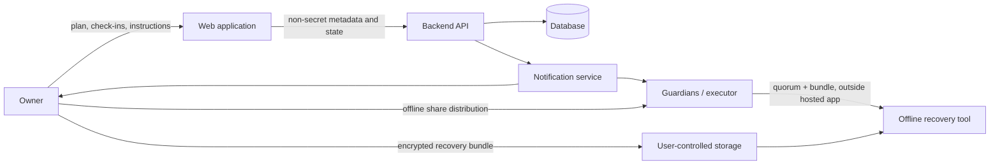

# Product and System Design

## 1. Product thesis

Self-custody creates a responsibility that ordinary account recovery does not solve: the owner may be the only person who knows how to access the assets. A family member or executor may know that crypto exists but not know which wallets, chains, hardware devices, recovery backups, or instructions matter.

The product is an **inheritance coordination layer**, not a wallet, exchange, custodian, probate authority, or automated death oracle.

### Positioning

“Make your self-custody setup understandable and recoverable by the people you trust—without handing your keys to a company.”

Avoid positioning the app as “we recover lost crypto.” It cannot recover a key that no longer exists, manufacture missing shares, prove death, override a hardware wallet, or guarantee legal ownership transfers.

## 2. Target users

- Self-custody holders who are not comfortable explaining seed phrases, derivation paths, hardware wallets, multisig, or chain-specific setup to family.
- Families/executors who need a clear inventory and instructions, but should not need to operate the owner's wallet today.
- Advanced holders who want a documented, threshold-based offline recovery plan and are willing to understand its trade-offs.

## 3. Core problem

The failure is often a chain of missing information, not just a lost seed phrase:

1. Heirs do not know a wallet exists.
2. They cannot identify the network, account, hardware device, or wallet software.
3. They do not know where the recovery material is stored.
4. They cannot identify legitimate guardians or the executor.
5. They may be tricked by fake support, recovery services, phishing pages, or malicious apps.
6. They may expose a seed phrase while trying to recover funds.

The product should solve discovery, documentation, coordination, and safe recovery education first.

## 4. Product layers

### Layer A — Inheritance plan (MVP)

- Wallet and account inventory using public addresses and user-entered labels only.
- Chain, wallet application, hardware device model, multisig participants, and recovery-instruction metadata.
- Named heirs, executor, and trusted guardians with explicit roles.
- Owner check-in cadence, multiple reminders, long grace period, and independent emergency-cancel code.
- A clear status timeline: active, reminder window, overdue, grace period, guardian review, and archived/cancelled.
- Human-readable instructions and printable/exportable recovery plan.
- Guardian onboarding and contact-verification workflow.
- No seed/private-key fields and no private-key wallet connection.

### Layer B — Offline encrypted recovery kit (future, gated)

- A standalone/offline tool creates a recovery package on the user's device.
- The user encrypts the package with a random data-encryption key (DEK).
- A standards-based threshold scheme divides the DEK into guardian shares.
- The encrypted package is stored by the user in one or more user-controlled locations; shares are held separately by guardians or in physical/offline custody.
- Heirs use an open-source offline recovery tool to reconstruct the DEK and decrypt the package.
- The hosted service never receives plaintext package data, DEK, or usable shares.
- This layer is not enabled until the cryptographic design decision, interoperability tests, independent review, and witnessed recovery drills are complete.

### Layer C — Chain-specific inheritance (not MVP)

Potential future modules include Bitcoin Miniscript/timelock policies or EVM smart-account modules. These are separate products with chain-specific assumptions, attack surfaces, audits, and recovery paths. Do not add a generic “inheritance smart contract” to the first release.

## 5. Core system model

The app coordinates people and status. The offline tool performs cryptographic recovery. The arrows deliberately do not route secret material through the backend.

## 6. The hard truth about inactivity and death

No web service can reliably infer death from silence. A user may be travelling, hospitalized, offline, locked out, have lost email access, or intentionally stop using the app. A guardian may be malicious, mistaken, coerced, or compromised.

Therefore:

- The status is “check-in overdue” or “owner unresponsive,” never “confirmed deceased.”
- A state transition can notify people and provide instructions; it must not automatically transfer assets.
- A missed check-in is not a cryptographic lock. If a guardian already possesses a threshold share and the encrypted bundle is available, they may be able to recover it before the configured date.
- The UI must explain this limitation before the owner distributes shares.
- Stronger time-based enforcement requires a different trust model (e.g., chain-specific scripts/contracts, a trusted executor, or a cryptographic time-lock construction) and is not part of this MVP.

## 7. Trust model and user choices

Provide two clearly explained guardian profiles:

| Profile | Example | Trade-off |
|---|---|---|
| Personal | 2-of-3 guardians | Easier to coordinate; two guardians can collude or be compromised |
| Resilient | 3-of-5 guardians | Better separation; more operational complexity and greater risk of losing too many shares |

These are examples, not mandatory protocol constants. The threshold and supported maximum must be chosen only after the selected standard/library is proven to support them. Never allow 1-of-N in a high-security profile.

Guardians should be independent people, not five email accounts controlled by one person. Encourage different households, devices, and physical locations. Avoid collecting detailed physical hiding places or safe combinations in the hosted database.

## 8. Product principles

1. **No custody:** we never control funds or signing keys.
2. **No magic recovery:** missing secrets cannot be recreated.
3. **Open recovery:** the owner can export the plan and use offline tools without the hosted service.
4. **Least knowledge:** the web service stores only what it needs to coordinate.
5. **Explicit trust:** explain who can collude, what can be revoked, and what cannot.
6. **Fail closed:** uncertain state or invalid recovery bundle blocks recovery rather than guessing.
7. **Recovery-first UX:** setup is not complete until the owner has rehearsed a recovery drill.
8. **No false security marketing:** no “unhackable,” “military-grade,” or guaranteed-death-detection claims.

## 9. Metrics that matter

- Setup completion rate with verified guardian contacts.
- Percentage of owners who complete a successful simulated recovery drill.
- Percentage of plans with a recent export and documented external backup location (without revealing that location).
- Percentage of overdue events cancelled by the living owner (used to tune reminder/grace UX, not to judge the owner).
- Recovery drill success rate and median time, segmented by user capability.
- Zero accepted reports of secrets reaching server logs, telemetry, or app APIs.
- Number and severity of unresolved security findings.

Do not optimize for TVL, wallet balances monitored, or number of keys uploaded. This is not an asset-management product.
